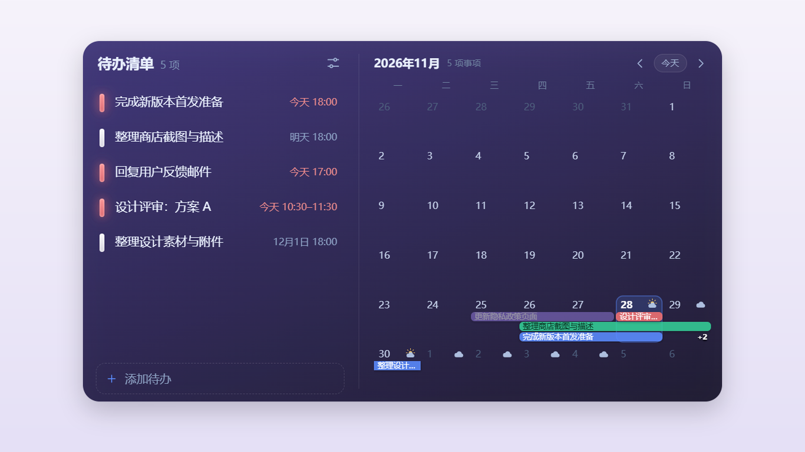
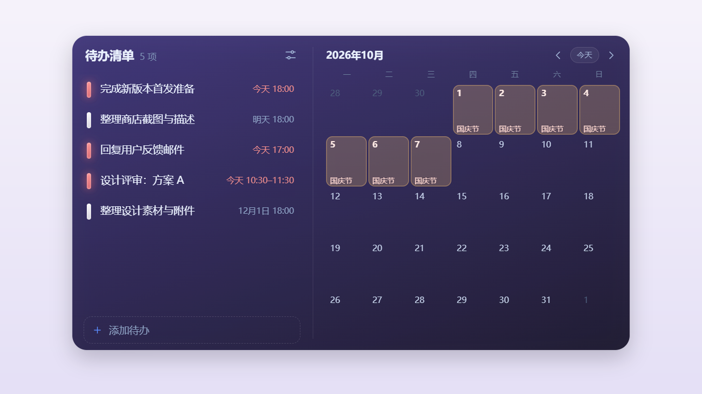

# 功能展示

## 截图

### 待办清单

悬停显示完成 / 置顶 / 结束时间 / 删除；左侧竖条颜色表示状态（白：正常，黄：30 分钟内，红：已超时）。

### 极简模式

单行显示，适合贴在屏幕角落长期挂着。

### 日历模式

左侧待办 + 右侧月历，事项按时间段画成色条。

### 农历 · 节气 · 每日一句

点击日期格查看农历、节气与每日一句。

### 法定节假日

自动标注法定节假日（数据来自 holiday-cn）。

### 贴边收纳

拖到屏幕边缘自动收起，只留一条窄边；鼠标滑过自动弹出。

---

以上截图由真实界面（CDP 截图 + Pillow 合成）生成，分辨率 1366×768，可直接用于 Microsoft Store 商店截图。
